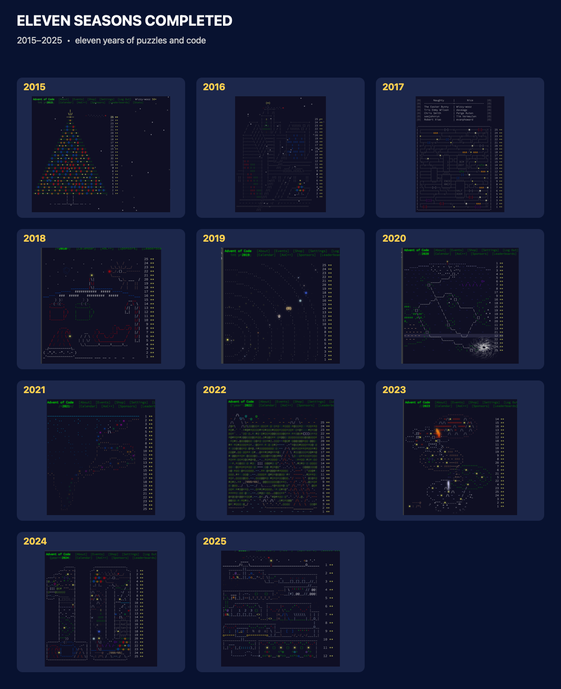

# Advent of Code: Make Your December Fun!

Every December, a new trail of puzzles appears: follow clues, untangle odd little machines, and earn stars one challenge at a time. This repository is a year-by-year notebook for that winter coding tradition—from the very first season to the next one on the horizon.

## Eleven seasons completed

From the first stars in 2015 through the latest finished season in 2025, eleven Decembers of puzzles solved and memories made.

## Choose your December

| Year | Season |
|:---:|:---|
| [2015](https://adventofcode.com/2015/events) | The first journey ✨ |
| [2016](https://adventofcode.com/2016/events) | A fresh set of stars 🌟 |
| [2017](https://adventofcode.com/2017/events) | More puzzles in the snow ❄️ |
| [2018](https://adventofcode.com/2018/events) | Another December, another quest 🧭 |
| [2019](https://adventofcode.com/2019/events) | Code through the cosmos 🚀 |
| [2020](https://adventofcode.com/2020/events) | A season of surprises 🎁 |
| [2021](https://adventofcode.com/2021/events) | Follow the trail of stars ⭐ |
| [2022](https://adventofcode.com/2022/events) | Puzzles from the North Pole 🛷 |
| [2023](https://adventofcode.com/2023/events) | Another year, another adventure 🧩 |
| [2024](https://adventofcode.com/2024/events) | December, decoded 🔍 |
| [2025](https://adventofcode.com/2025/events) | The latest completed chapter 📚 |
| [2026](https://adventofcode.com/2026/events) | The next chapter awaits… 🌠 |

Pick a year, open a puzzle, and let the countdown begin.
